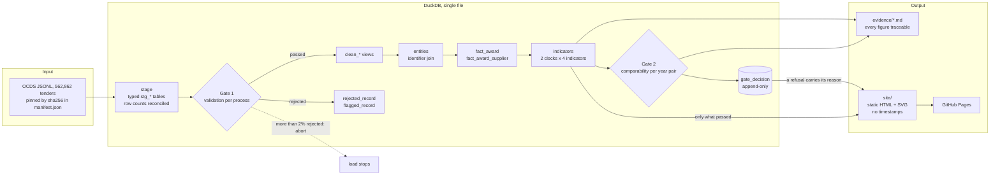

# Architecture

One idea shapes the whole design: **a number is published only if the pipeline can say why it
may be trusted, and the reason is stored.** Everything below serves that.

## Data flow

| Layer | Code | What it guarantees |
|---|---|---|
| Input | `appalti download`, `manifest.json` | The input is the exact file with the pinned sha256. Every stage refuses to run on a mismatch. |
| Stage | `sql/stage`, `appalti stage` | Typed extraction from JSON, one connection per step, row counts reconciled against the raw file. |
| Gate 1 | `sql/validate`, `gate1.toml` | Records are rejected per process with a reason. More than 2% rejected aborts the load. Later stages read only `clean_*`. |
| Entities | `sql/entities`, `appalti resolve build` | Identifier join on the normalised tax id. No name matching was applied; the audit decides whether any rule may be (D034, D036). |
| Facts | `050_facts.sql` | One row per award, with data-quality flags carried as columns, never silently dropped (D014, D025). |
| Indicators | `sql/indicators`, `appalti indicators` | Each figure carries its n and, where a field can be absent, its populatedness. Awarded value, concentration and procedure mix are computed on both the award-year and tender-year clock (D032). |
| Gate 2 | `appalti gate check`, `gate.toml` | Every period and every pair of consecutive years is judged against limits fixed in advance. Each judgement is a row in `gate_decision` with its measures and reason. |
| Site | `appalti site build` | Renders only what passed. A refused comparison prints its reason where the chart would be. |

## The two gates

**Gate 1 asks: is this record valid?** It runs at ingestion. Its rejections are counted and
published, and every indicator page states how many processes it excluded (D031).

**Gate 2 asks: is this year comparable with the next one?** It runs after the indicators are
computed and judges three measures per pair: populatedness spread, volume ratio of record counts,
and drift of the sector mix. Thresholds live in `gate.toml`; changing them is a new decision entry,
not an edit. A year that passes alone but has no comparable neighbour is refused as well (D040,
recorded as post hoc). `appalti gate sensitivity` shows which judgements flip under other limits
without changing the published ones (D043).

## Design decisions that matter most

| Decision | Why | Entry |
|---|---|---|
| Plain SQL files and a single DuckDB file | Every step can be read, diffed and rerun; no service to operate. | D002, D003 |
| The gate lives in application code with an append-only table | DuckDB's constraint enforcement is weaker than PostgreSQL's, so a foreign key cannot be the control. | D002 |
| Pin the input by sha256 | Published numbers must trace to one file. | D001 |
| Entity resolution is an identifier join | Recon found 100% id completeness; the audit then tested whether a name rule could be justified, and did not find one (succession 3 of 13). | D020, D034, D036 |
| Two clocks | The release year measures the publisher's loading behaviour, not procurement; the award and tender years are shown side by side. | D015, D032, D037 |
| Refuse instead of caveat | A trend across years with different coverage measures the publisher, so the site prints the refusal. | D016, D038 |
| Commit `site/` | It has no timestamp, so `git diff site/` shows which published numbers changed. | D005, D039 |
| CI proves the pipeline, Pages serves the full-data site | The 2025 file alone would produce a nearly empty site. | D039 |

## Reproducibility and its limits

- Same input and same code give the same ids and the same site. The entity id is a hash of the
  normalised key, slices use `hash(ocid) % N`, and the site contains no timestamp.
- CI runs lint, the unit tests, and the real pipeline on the 2025 file, and fails if Gate 2
  judged nothing. The full-file run is done locally and its result is committed.
- Memory: one connection per step, two threads, slices for the heavy extractions. The target
  is a laptop, not a cluster.

## What this design does not do

- No streaming, orchestration or concurrency: single-node batch over a frozen dataset.
- No cloud services. The only hosted piece is GitHub Pages serving static files.
- No claim beyond the data: awarded is not spent, below 40,000 euro is absent, and a single
  bidder is not evidence of wrongdoing (see the non-claims on every site page).
- The entity audit labels were drafted by Claude and reviewed by the author; the test split is
  unopened (D036).
